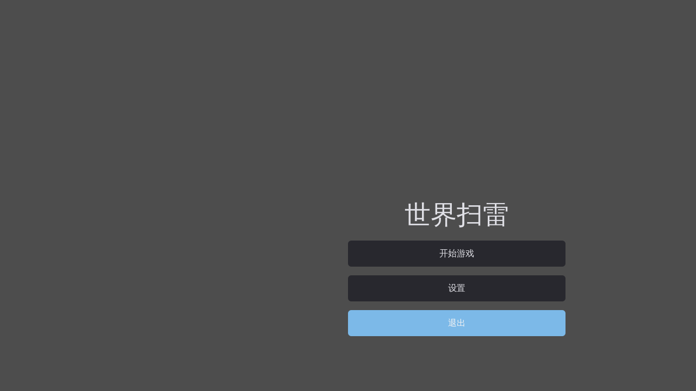
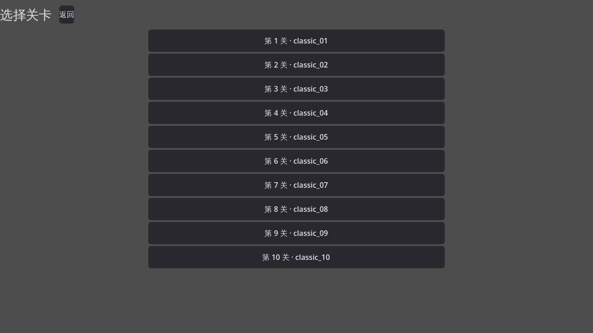
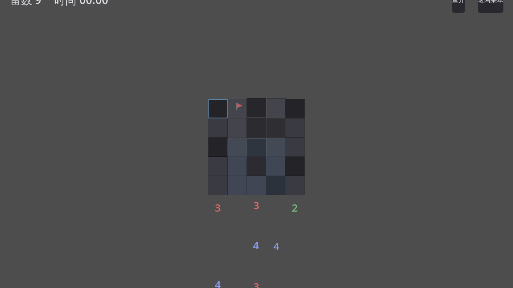

# 世界扫雷 · World Minesweeper

> 以「变体算子」为核心内容单位、以「序贯无猜」为质量红线的变体扫雷逻辑解谜游戏。


| 主菜单 | 关卡选择 | 对局中 |
|---|---|---|
|  |  |  |

## 这是什么

一款用 **Godot 4.7（.NET / C#）** 打造的变体扫雷解谜游戏。核心玩法在经典扫雷之上叠加
**22 种原创「变体算子」**（对角计数、拓扑变形、遮蔽、组合约束……），每个官方关卡都经过
**构造式布雷 + 求解器验证**，保证：

- **R01 序贯无猜** —— 官方关卡全程可逻辑演绎推进，任何时刻不存在必须二选一的局面；
- **R02 提示不害人** —— 三档求助深度由 CP-SAT 求解器背书，只认「不可行」判定，超时绝不当作不可行；
- **R03 构造式布雷** —— 不用「随机撒雷 + 拒绝重采」，每个算子自带构造式布雷；
- **H1 零导入** —— 全部关卡由种子复现生成，不读取任何外部题库数据。

### 内容规模

| 项目 | 数量 |
|---|---|
| 发布关卡集（4 尺寸 5×5–8×8） | 876 集 / 87,600 关 |
| 9×9 扩展层（满配） | +492 集 / +49,200 关 |
| 正式变体算子 | 22 种 |
| 难度档 | 普通 / 困难 / 噩梦（峰值深度落窗判据） |

## 技术亮点

- **求解内核**：Google OR-Tools **CP-SAT**（C#，`solver/RuleSolver.cs`）负责唯一解计数与
  不可行判定；GDScript 侧实现回退枚举（`core/brute_force_oracle.gd`）。
- **自举式规则平台**：GDScript RuleBuilder 产出可组合约束 IR（`core/cp_ir.gd`），
  翻译为 CP-SAT 模型 —— 新算子只需声明约束，难度验证与提示生成自动可用。
- **关卡库**：`levels/` 为按算子组织的关卡定义，`levels_lib/` 为批量生成的成品关；
  附带《关卡集总表.csv》全量对账。
- **Mod 平台骨架**：`ModAPI` autoload + godot-wasm 运行时 + 《变体规则编写规范.md》，
  关卡编辑器（`ui/level_editor.gd`）与创作中心开箱即用。
- **工程化**：GUT 单元 / UI / 集成三层测试、Roslyn + SonarAnalyzer 静态分析门禁、
  392 次提交的完整开发史。

## 快速开始

### 环境要求

1. **Godot 4.7.2 stable .NET**（[godotengine.org](https://godotengine.org/download) 下载 .NET 版）
2. **.NET SDK 9.0**（首次打开工程时 Godot 会自动恢复 NuGet 包，含 Google.OrTools）
3. Windows 平台首次运行会自动编译 C# 程序集（`世界扫雷 (Copy).csproj`）

### 运行

```bash
# 方式一：Godot 编辑器
#   打开 project.godot → 等待 C# 编译完成 → F5 运行（主场景：ui/level_select.tscn）

# 方式二：命令行
godot --path . --editor   # 先开编辑器编译
godot --path .            # 直接运行
```

### 运行测试（GUT）

```bash
godot --path . -s addons/gut/gut_cmdln.gd -gdir=res://test -ginclude_subdirs -gexit
```

## 目录结构

```
├── core/            # 游戏核心：棋盘/格子/算子/难度/求解/种子 RNG/成就/Mod API
├── ui/              # 界面层：关卡选择/对局/编辑器/提示/主题/会话管理
├── solver/          # C# CP-SAT 求解后端（RuleSolver.cs）
├── levels/          # 官方关卡定义（按算子 o1–o10 / 拓扑 shape_* / 动画 ani_* 组织）
├── levels_lib/      # 批量生成的成品关卡库（按 奥秘档/尺寸 频谱分布）
├── addons/          # 第三方插件：GUT 测试、debug_menu、godot-wasm、dialogue_manager…
├── demo/            # Mod 示例（含 web 演示）
├── test/ tests/     # GUT 测试（单元/UI/集成三层 + 种子回归金基线）
├── tools/           # 关卡批量生成/审计探针等开发工具
├── docs/            # 设计文档、变体规范示例
├── archive/         # 历史归档（ spike 脚本、早期 GDD 对标分析）
└── screenshots/     # README 与交付截图
```

核心设计文档：

- [`GDD_终版.md`](GDD_终版.md) —— 游戏设计总纲（三条设计红线 + 四条合规红线）
- [`变体规则编写规范.md`](变体规则编写规范.md) —— 变体算子/Mod 规则编写规范
- [`难度体系v2_遮蔽旋钮.md`](难度体系v2_遮蔽旋钮.md) 等难度体系文档
- [`docs/plans/`](docs/plans) —— 各专项实施计划存档

## 许可证

- **本仓库代码**：[MIT License](LICENSE)
- **内置字体**（`assets/fonts/`）：全部为 **SIL Open Font License 1.1** 授权，许可文本见
  [`assets/fonts/licenses/`](assets/fonts/licenses)
  - 文渊圆体 WenYuanRoundedSCVF（全局 UI 默认字体，46.5 MB 可变字体）
  - 源柔ゴシック GenJyuuGothic-Heavy（备用标题字体）
- **第三方插件**（`addons/`）各随附独立 LICENSE：GUT、debug_menu、godot-wasm、
  dialogue_manager、godot_mcp、godot_ai、godotsteam（仅开发链使用，未随导出发布）

> ⚠️ 仓库含 46.5 MB 全量中文字体以支撑开箱即跑；做发行版导出前建议按
> [`assets/fonts/README.md`](assets/fonts/README.md) 的指引做子集化。

## 完整备份与恢复

[`_backup/`](_backup/README.md) 内含本项目周边的全部历史数据：E 盘 kim 主项目快照及其完整 git
历史（bundle）、暂存关卡 tar 分卷（614MB，192,532 个成员）、相关 Python 原型、MVP 交付包等，
并附分卷合并与恢复步骤。**克隆本仓库即可在其他电脑完整还原整个项目**（素材源库除外，见
_backup/README.md 的「重新获取方式」）。

## English Summary

**World Minesweeper (世界扫雷)** is a variant minesweeper logic-puzzle game built with
**Godot 4.7 (.NET/C#)**. On top of classic minesweeper it layers **22 original variant
operators** (diagonal counting, topology deformation, occlusion, combined constraints…).
Every official level is **constructor-generated and solver-verified (Google OR-Tools
CP-SAT)** to guarantee *sequential no-guess solvability* — pure logic all the way, no
coin flips. Ships with **876 level sets / 87,600 levels** (up to 1,368 sets / 136,800
with the 9×9 expansion), a three-tier difficulty system, a level editor, a Wasm-based
mod platform skeleton, and GUT unit/UI/integration tests.

- **Engine**: Godot 4.7.2 .NET / .NET 9
- **Solver**: Google OR-Tools CP-SAT (`solver/RuleSolver.cs`) + GDScript fallback
- **License**: MIT (code), SIL OFL 1.1 (bundled fonts)

See the Chinese sections above for full details.
